# ravyn-rose

A desktop for KDE Plasma 6 that you switch on and off, in five flavours.

`rice on` saves your current look, repaints the desktop and tiles a set of panels around your
music: synced lyrics, a player, an album-art panel drawn in ASCII, a spectrum, cmatrix, a lava
lamp and a terminal that puts on a small show. `rice off` closes all of it and puts your
colours, wallpaper and window rules back exactly as they were.


That is a screen recording of Meta+Alt+T pressed five times while music plays
([the same in full quality](assets/flavours.mp4)). Nothing restarts and no window closes.

Nothing autostarts and nothing is changed for good. It is a costume, not a new wardrobe.

## Flavours

A flavour changes the colours and the shapes: gaps, frames, buttons, the spectrum, the tile
map, the wallpaper, even the lettering of the logo.

| MONO | ROSE | NEON | AMBER | PAPER |
|---|---|---|---|---|
| <a href="assets/mono-desktop.png">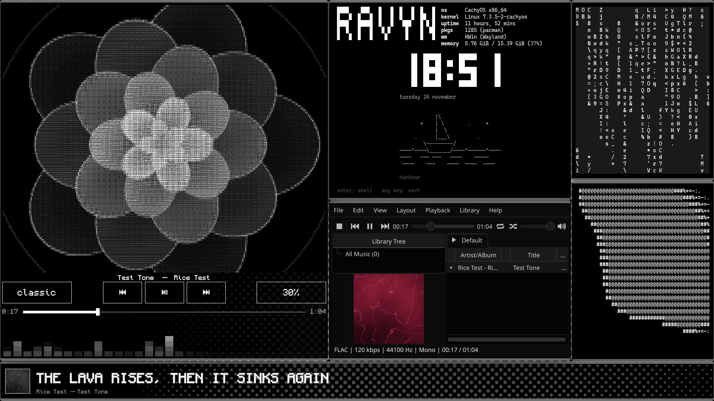</a> | <a href="assets/rose-desktop.png"></a> | <a href="assets/neon-desktop.png"></a> | <a href="assets/amber-desktop.png">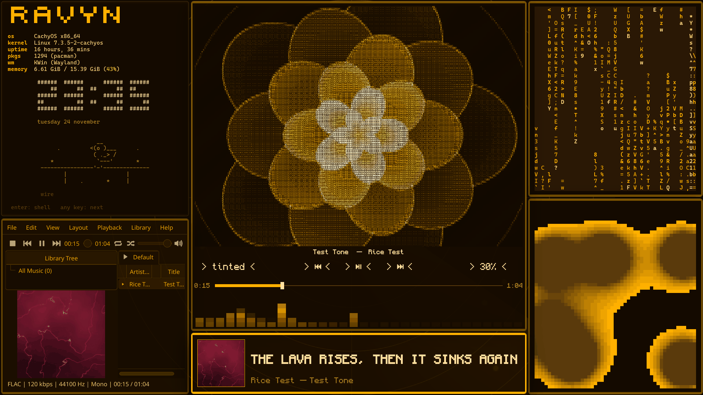</a> | <a href="assets/paper-desktop.png"></a> |

### Switching

Switching is live. The deck, the lyrics bar and the terminal showcase fade to the new colours,
the wallpaper cross-fades, frames and gaps change, and the tiles move to the new flavour's map.
On the laptop this was built on it takes about 0.7 to 1.1 seconds.

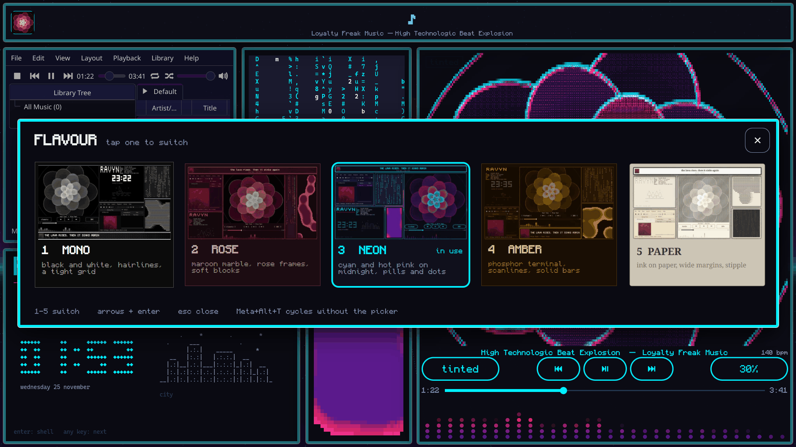

| Way | How |
|---|---|
| Key | Meta+Alt+T for the next flavour, Meta+Alt+F for the picker |
| Picker | click or tap a card; it stays open so you can try them in turn ([in motion](assets/picker.gif)) |
| Panel and menu | the "Rice flavour" button |
| KRunner | type `rice mono`, `rice neon`, ... |
| Command | `rice flavour mono`, `rice flavour next`, `rice flavour random` |

The cards are sized for fingers and wrap to two columns in portrait. Every key and way to
switch is listed in [SHORTCUTS.md](SHORTCUTS.md).

### MONO

Black and white. Two-pixel gaps, hairline frames, square outlined buttons, solid spectrum
bars, lyrics in capitals along the bottom, a halftone wallpaper.


| Terminal | Music | Tablet |
|---|---|---|
| <a href="assets/mono-terminal.png"></a> | <a href="assets/mono-music.png"></a> | <a href="assets/mono-tablet.png"></a> |

The player shows the track's own cover, so a colour cover stays in colour there.

### ROSE

Maroon marble and rose frames. Bracket buttons, a segmented spectrum, lyrics across the top.

| Desktop | Terminal | Music | Tablet |
|---|---|---|---|
| <a href="assets/rose-desktop.png"></a> | <a href="assets/rose-terminal.png">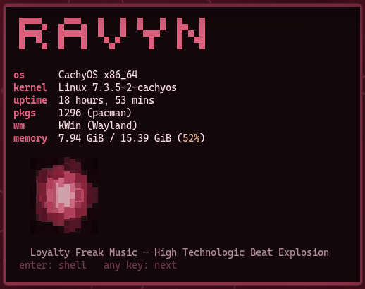</a> | <a href="assets/rose-music.png">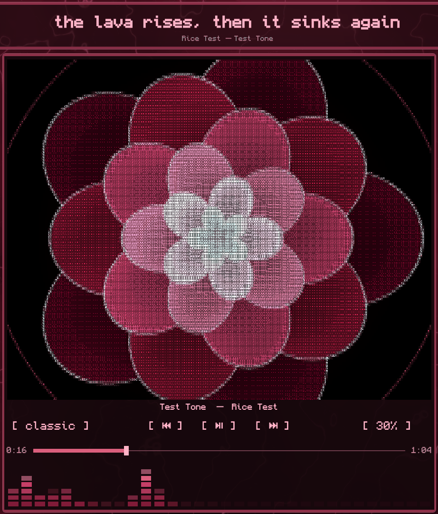</a> | <a href="assets/rose-tablet.png">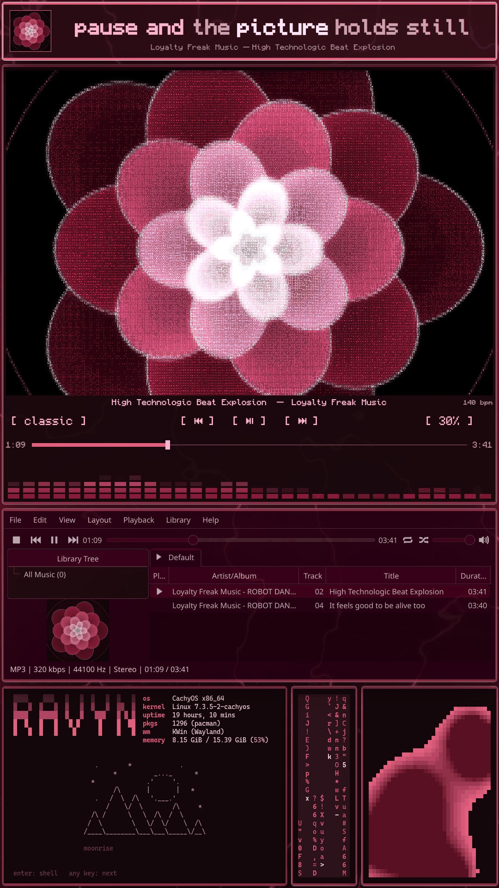</a> |

### NEON

Cyan and hot pink on midnight. Wider gaps, thicker frames, pill buttons, a spectrum made of
dots, a round seek knob, the deck on the right.

| Desktop | Terminal | Music | Tablet |
|---|---|---|---|
| <a href="assets/neon-desktop.png"></a> | <a href="assets/neon-terminal.png"></a> | <a href="assets/neon-music.png">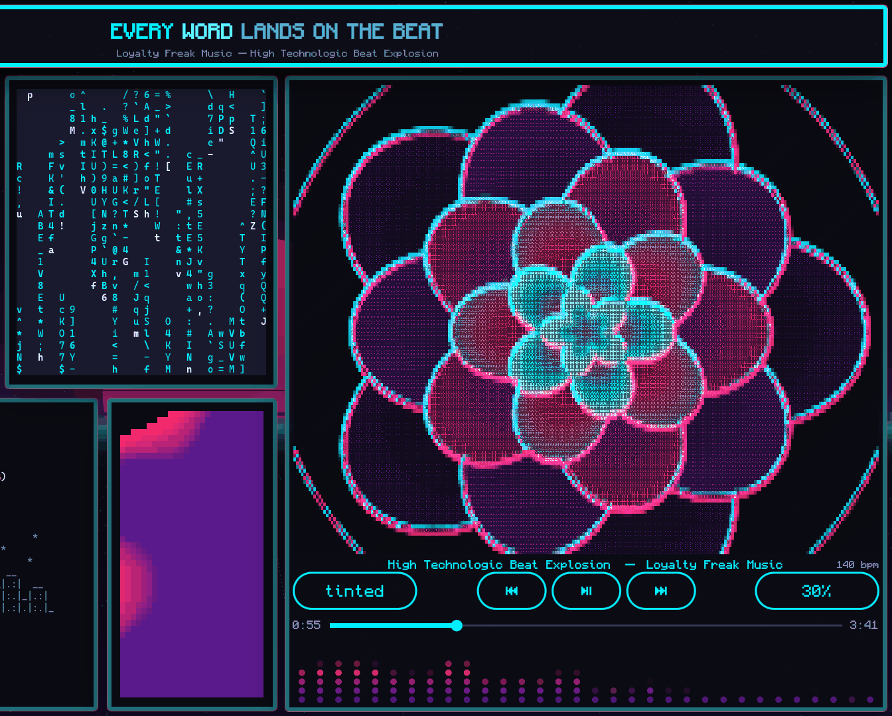</a> | <a href="assets/neon-tablet.png"></a> |

### AMBER

An amber phosphor terminal. `> <` buttons, solid bars, scanlines across the art, the lyrics
under the deck instead of above it.

| Desktop | Terminal | Music | Tablet |
|---|---|---|---|
| <a href="assets/amber-desktop.png"></a> | <a href="assets/amber-terminal.png">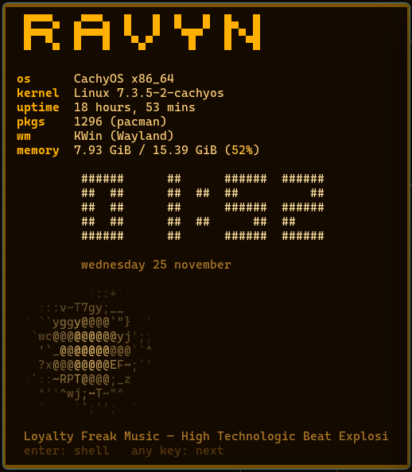</a> | <a href="assets/amber-music.png">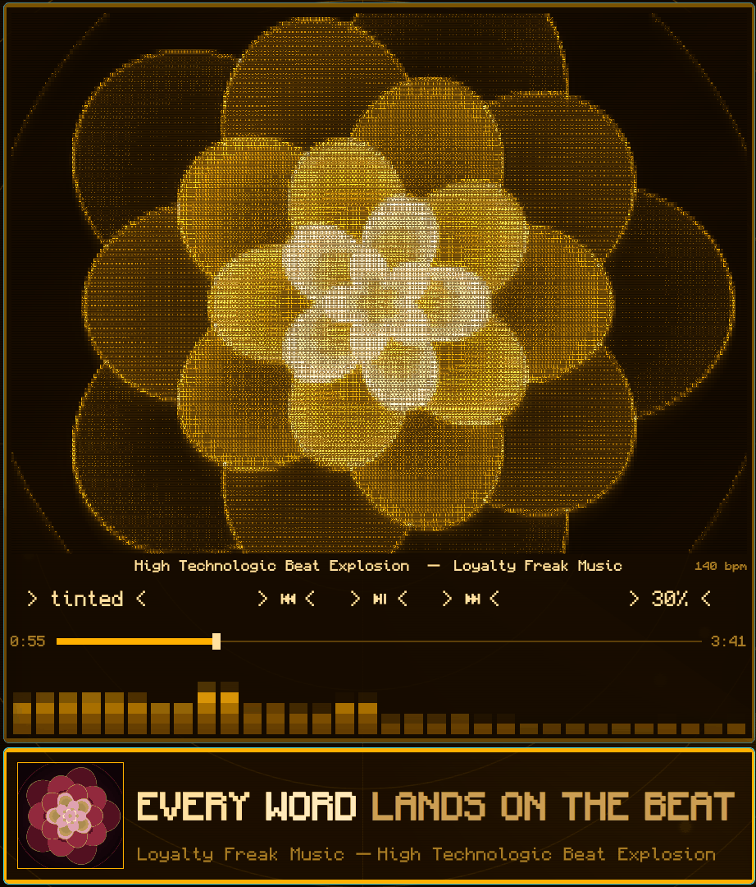</a> | <a href="assets/amber-tablet.png">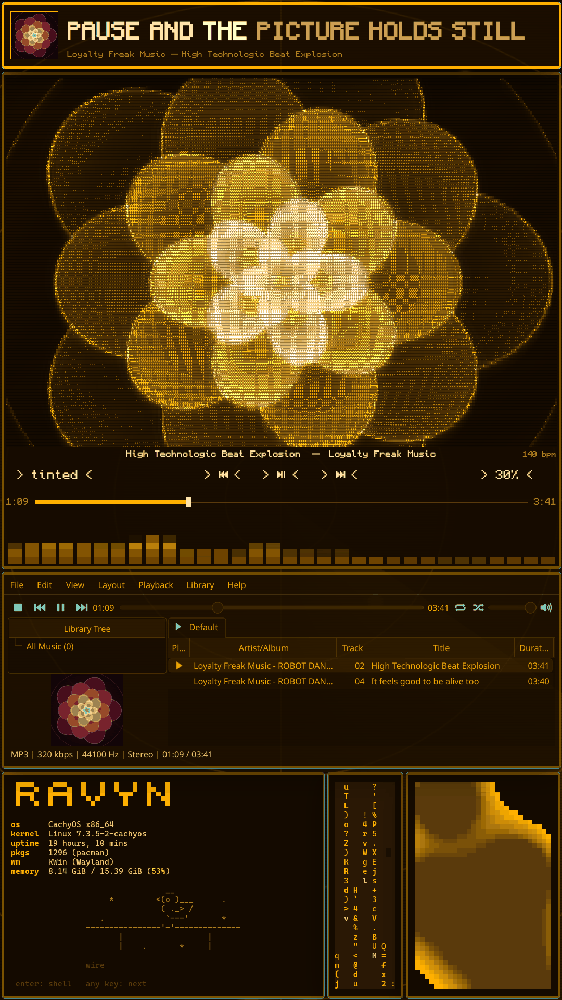</a> |

### PAPER

Ink on paper, and the only light one. Wide margins, heavy frames, serif type, boxed buttons,
stippled dots, the art drawn in braille, a contour-map wallpaper.

| Desktop | Terminal | Music | Tablet |
|---|---|---|---|
| <a href="assets/paper-desktop.png"></a> | <a href="assets/paper-terminal.png"></a> | <a href="assets/paper-music.png"></a> | <a href="assets/paper-tablet.png">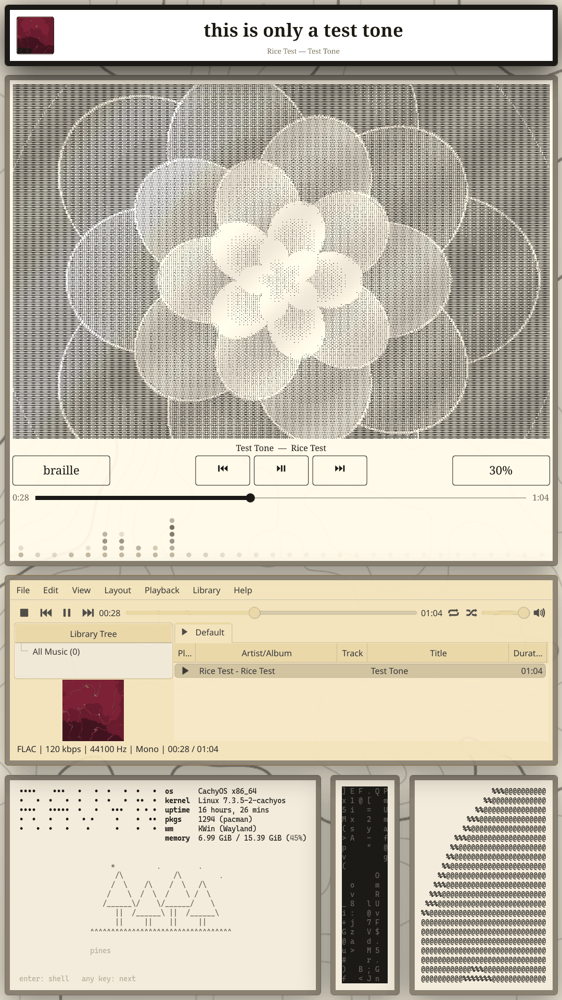</a> |

The track in these pictures is a generated test tone, the flower is a generated image and
the wallpapers are drawn by a script. No real album art appears anywhere in this repository.

### Your own

A flavour is one JSON file in `flavours/`: colours, shapes, panel settings and a tile map.
Copy one, change it, and run `rice flavour yourname`. `tools/wallpapers.py` shows how the five
wallpapers are drawn.

## What is in it

- **The toggle.** One script, `rice`, with a panel button and two shortcuts. Your `kdeglobals`,
  GTK colours, window rules and wallpaper are saved when it turns on and restored byte for byte
  when it turns off. Changing flavour keeps that saved copy.
- **Lyrics bar.** Follows whichever music player is actually playing and shows the current line,
  word by word, with the word being sung flashing on the beat.
  It reads a `.lrc` file next to the track first, then asks [LRCLIB](https://lrclib.net).
  Arabic lines are shaped and laid out right to left.
- **ASCII deck.** Cover art redrawn as characters by a GPU shader, in four modes: character
  ramp, half blocks, braille dots, and a tint in the flavour's colours. It moves with the
  music, differently in every flavour: see [Reactive deck](#reactive-deck). Play, pause, skip,
  seek, volume and a spectrum strip are built in, for mouse, keyboard and touch.
- **Terminal showcase.** The terminal tile opens on fastfetch with a RAVYN logo lettered
  differently for each flavour, a block clock, and a part that rotates between the playing
  track's cover (drawn by chafa) and six small ASCII scenes that move a little. It never prints
  a user or host name. Press Enter and it becomes an ordinary shell.
- **Classic layout.** `rice layout classic` swaps the deck for
  [cava](https://github.com/karlstav/cava) and [pipes.sh](https://github.com/pipeseroni/pipes.sh).
- **Side panels.** cmatrix and lavat, coloured and shaped by the flavour.
- **Two tile maps per flavour.** Landscape and portrait. Rotate the screen and the panels
  rearrange themselves.
- **Tablet-mode panel service** (optional, for 2-in-1 laptops). Makes the Plasma panel and tray
  icons finger-sized while the screen is folded back, and normal again when it is not.
- **Pen mode** (optional). A DRAW / NAVIGATE switch for touch-only styluses in Rnote, Xournal++
  and Krita, with stroke smoothing turned on in each. See [Pen & tablet mode](#pen--tablet-mode).
- **Limits on itself.** Every panel runs in one systemd slice capped at one CPU core and 1.5 GB
  of memory. `rice off` stops that slice and nothing else. Music players are started outside
  it, so turning the rice off never stops your music.

Classic layout, here in NEON:

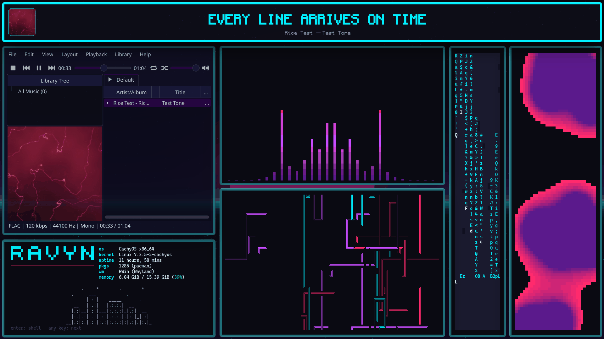

## Reactive deck

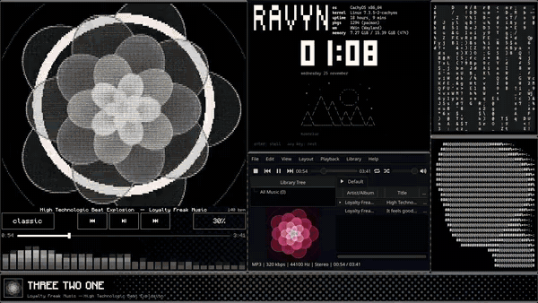

The deck and the lyrics bar move with the music. One small analyser listens to what the default
output plays (the sink's monitor through PipeWire, never a microphone) and works out bass, mids,
highs, loudness, beat onsets, tempo and the 32 spectrum bars. Every panel reads the same numbers
from the same clock, so the art, the spectrum strip and the lyric highlight pulse together.
Everything has an attack and a release; nothing flickers.

| Flavour | How the art reacts |
|---|---|
| MONO | A halftone dot swells under each character with the bass and shrinks back. A strong beat sends one clean ring of inverted cells out from the centre. |
| ROSE | A soft bloom breathes with the loudness. On a beat some characters are blown outward a little and settle back. |
| NEON | Edges light up cyan on one side and magenta on the other with the bass. A strong beat splits red and blue apart and slips a few bands of rows sideways for a moment. |
| AMBER | The phosphor flares sideways on a kick and leaves an afterglow that trails downward. The whole tube bulges slightly on every kick. |
| PAPER | The ink dots spread and run into each other with the bass, then dry back a shade lighter. |

Other moments:

- **Track change.** The old cover comes apart and its characters fall; the new one is written
  line by line from the top. 0.8 s.
- **Pause.** The art holds still and fades to a static one-bit dither. When the sound comes
  back it is alive again within a frame or two, with one pulse.
- **Volume.** A wave crosses the art and the spectrum, rightward for louder, leftward for quieter.
- **Lyrics bar.** With synced lyrics the line is shown word by word; the word being sung is the
  bright one and it flashes on the beat. The next line slides in from below. `.lrc` files carry
  one time per line, so the position inside a line is an estimate shared out by word length.
- **Tempo.** The BPM the analyser found is shown small next to the track title.

```
rice react full      # the default
rice react subtle    # the same reactions at under half the strength
rice react off       # nothing reacts; the spectrum strip keeps working
rice react on        # back to the level used last
rice react offset 40 # show everything 40 ms later (negative: earlier), if it looks off to you
```

The flavour picker has the same switch (`r`). If Plasma's animation speed is set to "instant",
nothing reacts and the transitions become plain swaps.

**Staying with the sound.** Sound reaches your ears later than it enters the audio graph: a few
tens of milliseconds on speakers, 0.1 to 0.3 s on Bluetooth. The analyser reads the delay
PipeWire reports for the output in use and stamps every value with the moment it should be
shown, so the picture follows what you hear and does not run ahead of it. For Bluetooth that
figure is the codec's estimate, not a measurement; `rice react offset` is there for that.

### Measured

On the test laptop (i5-8365U, UHD 620, 1920 x 1080 at 60 Hz, power-save governor), 12 s per
flavour while the demo track played, with `tools/react_bench.py`:

| Flavour | Deck frames per second | Frames later than 25 ms | Beat due to frame handed over: median / slowest | CPU, all four processes | GPU, deck |
|---|---|---|---|---|---|
| MONO | 59.9 | 1 of 718 | 14 ms / 27 ms | 41 % of one core | 26 % |
| ROSE | 59.9 | 1 of 718 | 13 ms / 28 ms | 50 % | 30 % |
| NEON | 59.9 | 1 of 718 | 16 ms / 30 ms | 49 % | 37 % |
| AMBER | 59.8 | 2 of 718 | 17 ms / 39 ms | 47 % | 32 % |
| PAPER | 59.8 | 6 of 718 | 16 ms / 41 ms | 49 % | 23 % |

- **Lag.** "Beat due" is the moment a beat should be on screen; the figure is how long after
  it the first frame showing it was handed to the compositor. The compositor then needs up to
  one refresh (16.7 ms) more, which this cannot see. On speakers the output itself plays about
  21 ms late (PipeWire's figure), so against what you hear the picture is typically 5 to 15 ms
  behind, and on the slowest frames about 40 ms. The detector itself fires a median of 5 ms
  after a kick starts (`react/analyser.py --selftest`).
- **CPU.** Analyser 10 to 12 %, deck 17 to 21 %, lyrics window 12 to 14 %, lyrics backend 2 to
  3 %, each as a share of one core. That is 5 to 6 % of this 8-thread CPU, and it is counted
  while the cores idle at their lowest clock; run flat out, the analyser's own work is 1.1 % of
  a core. Any Qt Quick window that repaints 60 times a second costs about 6 % here before it
  draws anything. Before this change the deck drew 15 frames a second and used about 8 %.
  With `rice react off`, or while nothing plays, the deck goes back to that or to nothing.
- **GPU** is the share of time the graphics chip's render engine worked for the deck's process.
- **Memory.** Analyser 33 MB, deck 193 MB, lyrics window 165 MB.

### Videos

30 s each, with sound: the build, the drop at 0:08, a volume change at 0:15, pause at 0:19 and
play at 0:21, the next track at 0:25.

[MONO](assets/react/react-mono.mp4) · [ROSE](assets/react/react-rose.mp4) ·
[NEON](assets/react/react-neon.mp4) · [AMBER](assets/react/react-amber.mp4) ·
[PAPER](assets/react/react-paper.mp4)

- **Music:** "High Technologic Beat Explosion" and "It feels good to be alive too" by
  [Loyalty Freak Music](https://freemusicarchive.org/music/Loyalty_Freak_Music/ROBOT_DANCE_/),
  from the album "ROBOT DANCE !", released under CC0 1.0. The covers in the videos were drawn
  for this demo, and the lines in the lyrics bar are demo text: both tracks are instrumental.
- **Frame rate.** These are real screen recordings, and the recorder kept about 40 of the 60
  frames a second, so the videos are a little less smooth than the screen was. The 60 in the
  table is the deck's own count, taken without the recorder running.
- **Sound.** Recorded from the audio output next to the screen and lined up with a sync mark
  shown just before each clip, then shifted by the 21 ms the speakers play late. That alignment
  is good to about one frame.

### Limits

- The tempo can settle on half or double the real one, as any tempo tracker can. It only
  changes the BPM read-out and how fast the MONO ring travels.
- In the classic layout the spectrum terminal is cava itself, which listens on its own.
- Watched and measured with one track on one laptop, on its speakers. With Bluetooth earbuds
  only the analyser was run: it read a 304 ms output delay and scheduled the picture 271 ms
  later, but nobody watched the result.

## Requirements

- KDE Plasma 6 on Wayland
- Arch Linux or an Arch-based system (built and used on CachyOS)
- systemd user session, PipeWire with WirePlumber

Packages are listed in [DEPENDENCIES.md](DEPENDENCIES.md). The installer works out which ones
you are missing.

## Install

```sh
git clone https://github.com/ravynarchlab-source/ravyn-rose.git && cd ravyn-rose && ./install.sh
```

To see every step first without changing anything, run `./install.sh --dry-run`.

What the installer does, in order:

1. Installs missing packages with `pacman` (it asks first, as pacman does). Packages that are
   not in your repositories go to `paru` or `yay` if you have one, and are skipped with a note
   if you do not.
2. Copies anything it is about to replace into `~/.local/state/ravyn-rose/backup`.
3. Copies the rice to `~/.local/share/rice`.
4. Downloads the Monocraft font from its own release page and checks its SHA-256.
5. Runs `rice setup`: launchers, shortcuts, the resource-limit slice, the two panel buttons
   (on/off and flavour picker), KRunner entries.

Options: `--touch` adds the tablet-mode panel service, `--pen` adds pen mode for touch-only
styluses, `--no-deps` leaves packages alone, `--no-button` skips the panel button,
`--no-setup` only copies files.

It does not turn the rice on. Do that yourself:

```sh
rice on
```

## Use

| Command | What it does |
|---|---|
| `rice on` / `rice off` | Turn it on, or put everything back |
| `rice toggle` | Whichever applies. This is what the panel button runs |
| `rice flavour NAME` | Switch flavour, live. No name opens the picker; `next`, `random` and `list` also work |
| `rice react on\|off\|subtle\|full` | How much the deck and the lyrics bar move with the music |
| `rice status` | Flavour, what is running, memory and CPU time |
| `rice player pear\|fooyin\|auto` | Which player gets the music tile |
| `rice layout deck\|classic` | ASCII deck, or cava and pipes |
| `rice uninstall` | Turn off and remove everything `rice setup` created |

| Shortcut | Action |
|---|---|
| Meta+Alt+N | rice on |
| Meta+Alt+O | rice off |
| Meta+Alt+T | next flavour |
| Meta+Alt+F | flavour picker |
| Meta+Alt+PgUp / PgDn | Volume up / down |
| Meta+Alt+, / . | Previous / next track |

A shortcut is only registered if the key is free. If one is taken, `rice setup` leaves it
alone and says so in `~/.local/state/rice/log`. The full list is in [SHORTCUTS.md](SHORTCUTS.md).

Inside the deck:

| Action | Keyboard | Mouse or touch |
|---|---|---|
| Play / pause | Space | the middle button |
| Previous / next | Left / Right | the outer buttons, or swipe across the art |
| Volume | `+` and `-` | wheel on the art, or drag up and down |
| Mute | M | tap the volume read-out |
| Seek | | click the progress bar |
| Art mode | Tab, or 1 to 4 | tap the mode name |
| Larger characters | Z | |
| Fill or fit the cover | F | |

Inside the terminal showcase: Enter, Space or `q` for a shell, any other key for the next page.

### Players

The lyrics bar and the deck follow [fooyin](https://www.fooyin.org) and
[Pear Desktop](https://github.com/pear-devs/pear-desktop) through MPRIS. Browsers are ignored
on purpose. Pear Desktop is the heavy one: when I measured, it used more CPU than all the
rice panels together.

### Changing things

- **Terminal tile:** `RICE_TERM_CMD="htop" rice on` runs something else in it;
  `RICE_TERM_CMD=shell` gives a plain shell.
- **Everything a flavour sets** (colours, gaps, frame width, button shape, tile map, panel
  options) is in its file in `flavours/`.
- **Scenes:** each file in `showcase/scenes/` is one scene; add your own.
- **Wallpapers:** `tools/wallpapers.py` draws all five (needs `python-numpy`).

All of these live in `~/.local/share/rice` after install.

## Pen & tablet mode

Two optional parts for 2-in-1 laptops. Neither needs the rice to be on.

### Tablet-mode panel

`./install.sh --touch` adds a small user service, `touch-mode-panel`. It listens for KWin's
tablet-mode signal. When the screen folds back, the panel grows to 52 px and tray icons scale
with it; when it unfolds, the saved height comes back. `TOUCH_HEIGHT` in the script sets the
size.

```sh
touch-mode-panel status
systemctl --user disable --now touch-mode-panel.service
```

### Pen mode

`./install.sh --pen` adds a DRAW / NAVIGATE switch for Rnote, Xournal++ and Krita.
`pen/install.sh` installs this part alone and leaves the rice out of it.

**Which pens it is for.** Touch-only styluses: the capacitive kind sold as "universal" or "for
all tablets", with or without a battery. The screen reads their tip as a fingertip. It was
built with one of those on a laptop whose screen would also take a real Wacom AES pen.

**What it cannot give you.** No pressure. No tilt, hover, eraser end or side buttons either.
None of that leaves a capacitive stylus, so no setting can add it: lines come out one width.
If your pen is a real active pen for your screen (Wacom AES, MPP, USI), you do not need this;
apps already tell such a pen from your hand. Not sure which kind you have? Run
`python3 ~/.local/share/pen-mode/pen-probe.py ~/pen-probe` and scribble: blue lines mean a
real pen, orange lines mean touch.

Because a touch stylus and a finger look the same, an app cannot know whether a stroke should
draw or scroll. The switch decides it for all three apps at once:

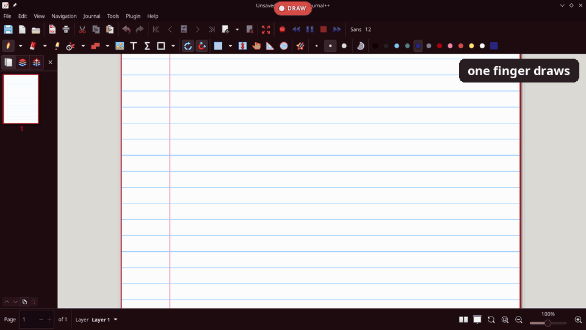

- one tap on the pill at the top centre of the screen. It is there while one of the three
  apps is running, says DRAW or NAVIGATE, and never takes keyboard focus;
- one tap on the tray icon (a pencil for DRAW, a four-way arrow for NAVIGATE);
- `Meta+Alt+D`;
- or `pen-mode draw`, `pen-mode navigate`, `pen-mode toggle` in a terminal.

A short on-screen message names the new mode. Apps that are open follow at once, apps that
are closed start in the current mode. `PEN_MODE_PILL=0` in the service turns the pill off if
the tray icon is enough for you.

| App | DRAW | NAVIGATE | Smoothing that setup turns on |
|---|---|---|---|
| Xournal++ | one finger draws; two fingers still pan and pinch-zoom | one finger scrolls | stabilizer: Gaussian averaging with inertia |
| Rnote | one finger draws; two-finger gestures only scribble here, so switch to NAVIGATE to move | one finger pans, two fingers pan and zoom | the "modeled" stroke builder, constant width |
| Krita | one finger paints; two fingers pan, zoom and rotate | the pan tool: one finger moves the canvas | brush stabilizer |

The same shaky test strokes, drawn by a simulated touchscreen after setup (`pen/tools/vtouch.py`):

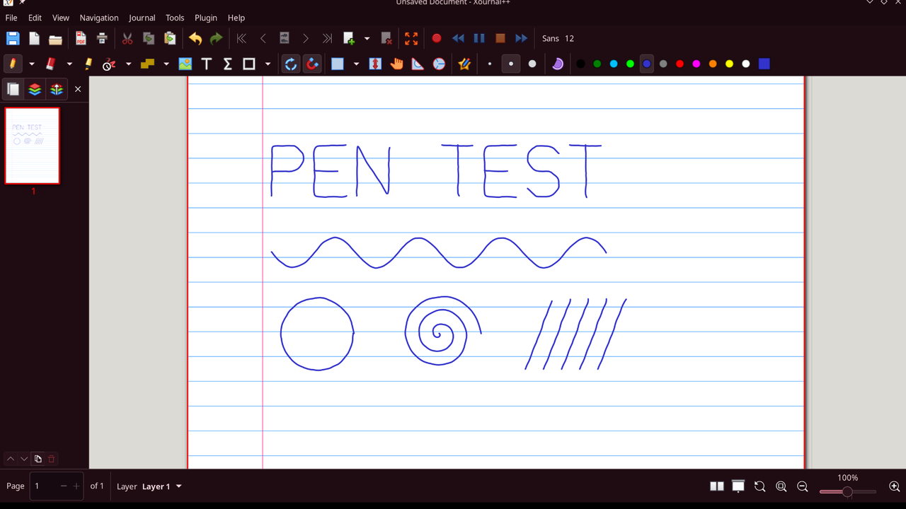
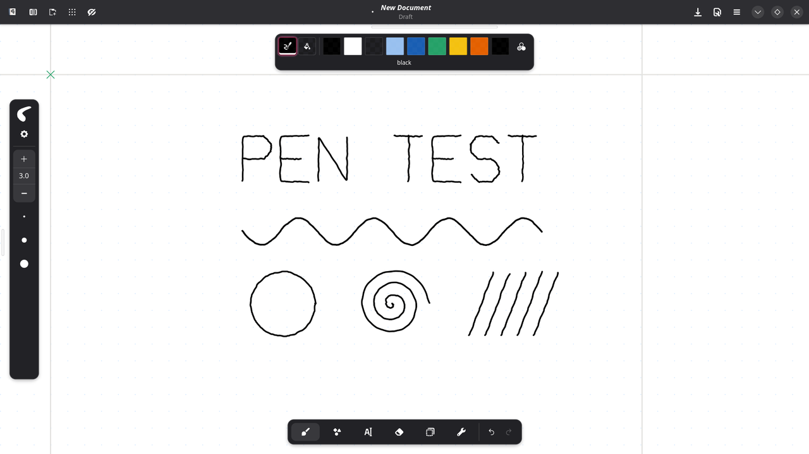

Two things about Krita. Its side of the switch is a small Python plugin, and Krita's Python
plugins need the `python-pyqt6` package. And through XWayland Krita now and then misses the
end of a touch stroke and stops painting until you change tool, so setup adds a second
launcher, "Krita (touch pen)", which starts it as a native Wayland app; there the strokes
all landed.

**Palm rejection is the weak point.** The touch panel this was built on reports no contact
size, so nothing can filter "big contact = hand". Its firmware seems to ignore a palm laid
flat: in the one test made, a sentence written with the hand resting on the glass produced no
stray contact. A
knuckle or the edge of the hand can still get through, and then Xournal++ cancels the stroke
and may zoom, Rnote joins the two contacts into a scribble, and Krita zooms or turns the
canvas. What helps: rest the whole hand or none of it, wear a two-finger drawing glove, and
keep undo close.

```sh
pen-mode status       # mode, and what each app is set to
pen-mode uninstall    # put the apps' own settings back, remove the switch
```

Setup changes a handful of settings in the three apps and saves the values it found in
`~/.local/state/pen-mode/originals.json` first. `pen-mode uninstall` writes exactly those
values back. Close the three apps before either step: they write their settings on exit.

## Uninstall

```sh
./uninstall.sh --dry-run
./uninstall.sh
```

This runs `rice off` first, so your look is restored from the toggle's own byte-exact copy.
Then it removes the files, launchers and shortcuts, and copies back anything that existed
before the install. If pen mode is installed, its own uninstall runs as well and writes the
three apps' settings back to what they were. Packages stay installed. The backup folder stays
too, until you delete it or pass `--purge`.

## What it sends over the network

- **Lyrics.** When a track has no `.lrc` file next to it, the artist, title, album and length
  are sent to lrclib.net to look up synced lyrics. Answers are cached in `~/.cache/rice`.
- **Cover art.** If your player reports the cover as a web address, that image is downloaded
  and cached.

That is all. No accounts, no keys, no telemetry, and it never reads a browser's or a player's
own data. The analyser behind the reactive deck listens to this machine's own audio output,
keeps only a couple of seconds of numbers in memory, and sends nothing anywhere.

## Tested, and not

Tested on CachyOS with KDE Plasma only. Built and used on one machine: CachyOS, Plasma 6.8,
Wayland, a 2-in-1 laptop at 1920 x 1080 with 125 % scaling. No other distribution and no other
desktop has been tried. All five flavours, both layouts, the portrait map and the off-and-restore
cycle were run there; the tablet pictures above were taken with the screen folded back.

- **Start-up of the terminal tile.** The showcase draws its first frame less than 100 ms after
  it starts (it logs the figure). The terminal emulator's own start comes on top of that: about
  half a second alone on this laptop, around two seconds when every panel launches at once.
- **Flavour switching.** All five were switched live there, many times, with every panel
  staying open; the times above come from the log. The two keys were pressed by a simulated
  keyboard, and the picker was driven by its shortcut and by its own demo mode, not by a
  finger. The picker's portrait layout was checked by rotating the screen.
- **Album art in the terminal** was run with chafa in all five flavours (the terminal pictures
  above). The fallback without chafa, half blocks drawn with Pillow, was run earlier.
- **The installer** has been run as a dry run and into an empty home folder, then uninstalled
  again with the earlier files coming back. It has not yet been run on a freshly installed
  system, so read the dry run before you trust it.
- **Pen mode** was installed for real on that laptop, and into an empty home folder and
  removed again, with the app settings coming back identical. Drawing, two-finger pan, pinch
  and the switch (pill, shortcut, command) were checked in all three apps with a simulated
  touchscreen and keyboard (`pen/tools/vtouch.py`); in Krita that was as a native Wayland app, where NAVIGATE picked the
  pan tool and DRAW gave the brush back. One real capacitive stylus was used by hand in
  Xournal++ and in the probe. It has not been used in Krita yet.
- **The reactive deck** was run in all five flavours on that laptop, on its speakers; the
  figures and the videos under [Reactive deck](#reactive-deck) were taken there. Bluetooth
  output got as far as the analyser reading its delay. Reduced motion and `rice react off` /
  `subtle` were checked in a hidden test compositor, not on the visible desktop.
- Multi-monitor setups and X11 are untested.

## Credits

None of the programs or fonts below are included in this repository. They are installed from
your distribution or downloaded from their authors, and each keeps its own licence.

| Project | Used for | Licence |
|---|---|---|
| [Monocraft](https://github.com/IdreesInc/Monocraft) by Idrees Hassan | Pixel font in the lyrics bar and deck | SIL OFL 1.1 |
| [Cascadia Code](https://github.com/microsoft/cascadia-code), patched by [Nerd Fonts](https://github.com/ryanoasis/nerd-fonts) | Terminal panels | SIL OFL 1.1 |
| [Noto fonts](https://fonts.google.com/noto) (Kufi Arabic, Serif) | Arabic lyric lines; the PAPER flavour | SIL OFL 1.1 |
| [Alacritty](https://github.com/alacritty/alacritty) | Terminal panels | Apache-2.0 / MIT |
| [fastfetch](https://github.com/fastfetch-cli/fastfetch) | System facts in the showcase | MIT |
| [chafa](https://hpjansson.org/chafa/) | Album art in the showcase | LGPL-3.0-or-later |
| [cava](https://github.com/karlstav/cava) | The classic layout's visualizer | MIT |
| [NumPy](https://numpy.org) | The analyser behind the reactive deck | BSD-3-Clause |
| Loyalty Freak Music, ["ROBOT DANCE !"](https://freemusicarchive.org/music/Loyalty_Freak_Music/ROBOT_DANCE_/) | Music in the demo videos (two tracks) | CC0 1.0 |
| [cmatrix](https://github.com/abishekvashok/cmatrix) | Matrix panel | GPL-3.0 |
| [lavat](https://github.com/AngelJumbo/lavat) | Lava panel | MIT |
| [pipes.sh](https://github.com/pipeseroni/pipes.sh) | Pipes panel | MIT |
| [fish](https://fishshell.com) | Shell behind the showcase | GPL-2.0 |
| [fooyin](https://www.fooyin.org) | Music player | GPL-3.0 |
| [Pear Desktop](https://github.com/pear-devs/pear-desktop) | Music player | MIT |
| [playerctl](https://github.com/altdesktop/playerctl) | Reading and driving players over MPRIS | LGPL-3.0 |
| [LRCLIB](https://lrclib.net) | Synced lyrics lookup | free public API (server is MIT) |
| [Qt 6](https://www.qt.io) and [PySide6](https://doc.qt.io/qtforpython-6/) | Lyrics window and deck | LGPL-3.0 |
| [Pillow](https://python-pillow.org) | Preparing cover art for the shader | MIT-CMU |
| [KDE Plasma, KWin, Breeze](https://kde.org/plasma-desktop/) | The desktop all of this sits on | LGPL-2.0-or-later |
| [PipeWire](https://pipewire.org) and WirePlumber | Volume control; what the analyser listens through | MIT |
| [Rnote](https://rnote.flxzt.net), [Xournal++](https://xournalpp.github.io), [Krita](https://krita.org) | The apps pen mode sets up and switches | GPL-3.0-or-later, GPL-2.0-or-later, GPL-3.0 |

## Licence

Everything in this repository is my own work and is released under the [MIT licence](LICENSE):
the scripts, the QML, the shaders, the flavours, the logos and scenes, and the wallpapers,
which `tools/wallpapers.py` draws from noise and geometry.
