# ravyn-rose

A desktop for KDE Plasma 6 that you switch on and off, in five flavours.

`rice on` saves your current look, repaints the desktop and tiles a set of panels around your
music: synced lyrics, a player, an album-art panel drawn in ASCII, a spectrum, cmatrix, a lava
lamp and a terminal that puts on a small show. `rice off` closes all of it and puts your
colours, wallpaper and window rules back exactly as they were.

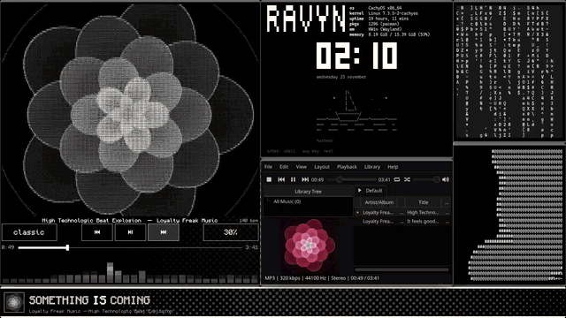

Nothing autostarts and nothing is changed for good. It is a costume, not a new wardrobe.

## Flavours

A flavour changes the colours and the shapes: gaps, frames, buttons, the spectrum, the tile
map, the wallpaper, even the lettering of the logo.

```sh
rice flavour mono      # or rose, neon, amber, paper
rice flavour           # a picker
rice flavour random
```

### MONO

Black and white. Two-pixel gaps, hairline frames, square outlined buttons, solid spectrum
bars, lyrics in capitals along the bottom, a halftone wallpaper.


| Terminal | Music | Tablet |
|---|---|---|
| <a href="assets/mono-terminal.png">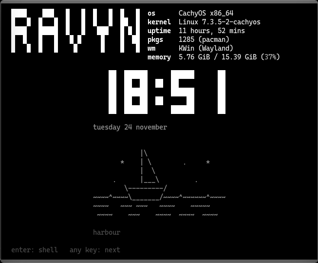</a> | <a href="assets/mono-music.png">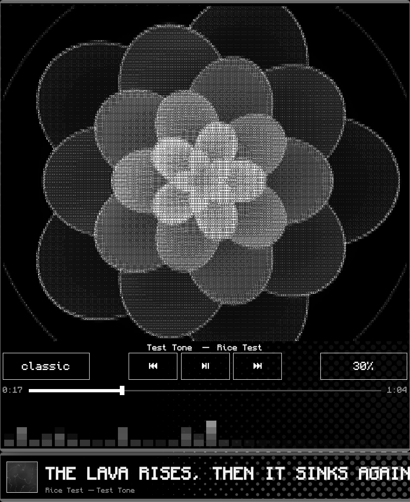</a> | <a href="assets/mono-tablet.png">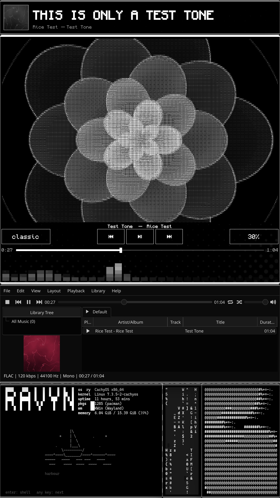</a> |

The player shows the track's own cover, so a colour cover stays in colour there.

### ROSE

Maroon marble and rose frames. Bracket buttons, a segmented spectrum, lyrics across the top.

| Desktop | Terminal | Music | Tablet |
|---|---|---|---|
| <a href="assets/rose-desktop.png">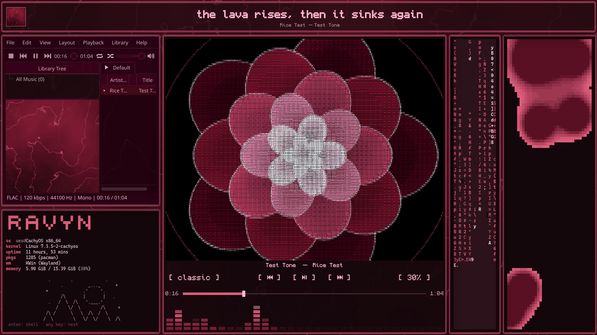</a> | <a href="assets/rose-terminal.png"></a> | <a href="assets/rose-music.png"></a> | <a href="assets/rose-tablet.png"></a> |

### NEON

Cyan and hot pink on midnight. Wider gaps, thicker frames, pill buttons, a spectrum made of
dots, a round seek knob, the deck on the right.

| Desktop | Terminal | Music | Tablet |
|---|---|---|---|
| <a href="assets/neon-desktop.png">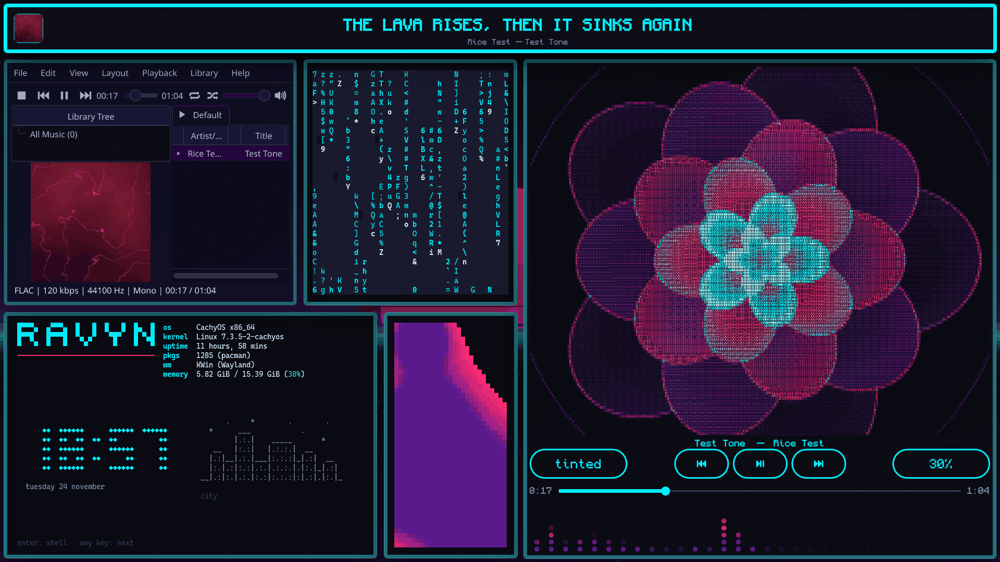</a> | <a href="assets/neon-terminal.png">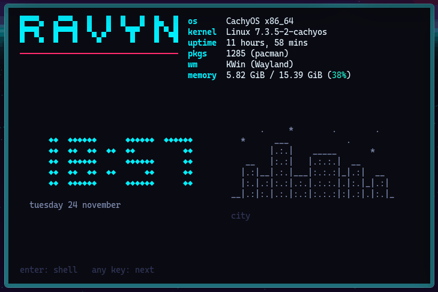</a> | <a href="assets/neon-music.png"></a> | <a href="assets/neon-tablet.png">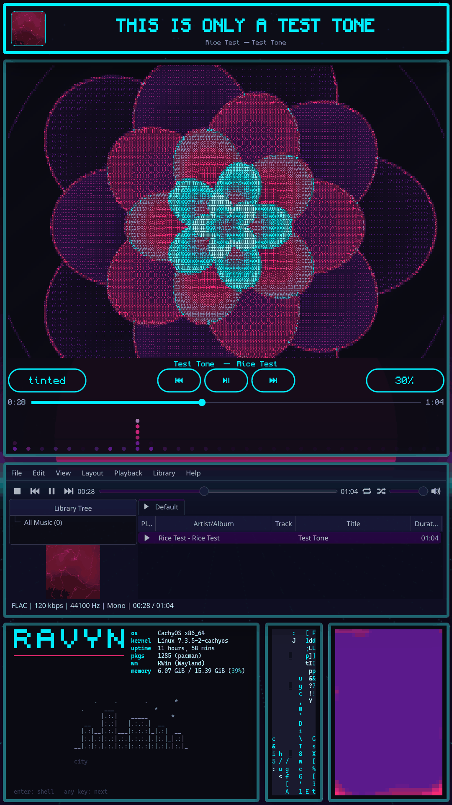</a> |

### AMBER

An amber phosphor terminal. `> <` buttons, solid bars, scanlines across the art, the lyrics
under the deck instead of above it.

| Desktop | Terminal | Music | Tablet |
|---|---|---|---|
| <a href="assets/amber-desktop.png"></a> | <a href="assets/amber-terminal.png"></a> | <a href="assets/amber-music.png"></a> | <a href="assets/amber-tablet.png"></a> |

### PAPER

Ink on paper, and the only light one. Wide margins, heavy frames, serif type, boxed buttons,
stippled dots, the art drawn in braille, a contour-map wallpaper.

| Desktop | Terminal | Music | Tablet |
|---|---|---|---|
| <a href="assets/paper-desktop.png">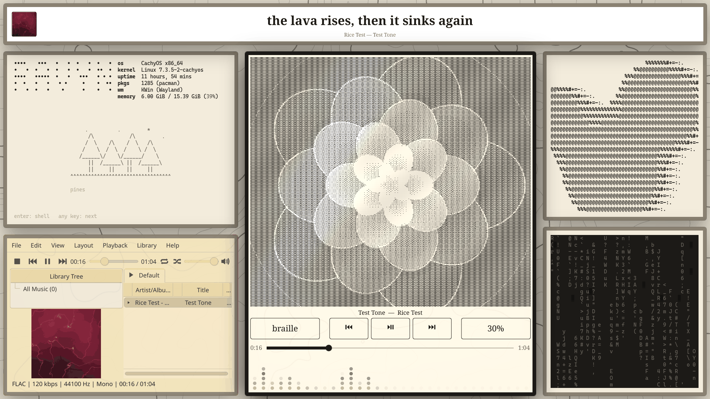</a> | <a href="assets/paper-terminal.png">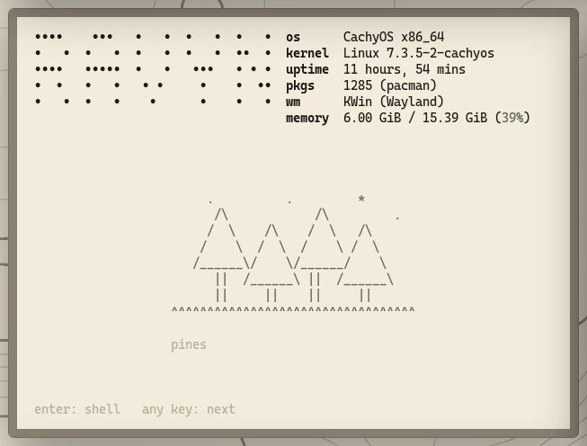</a> | <a href="assets/paper-music.png">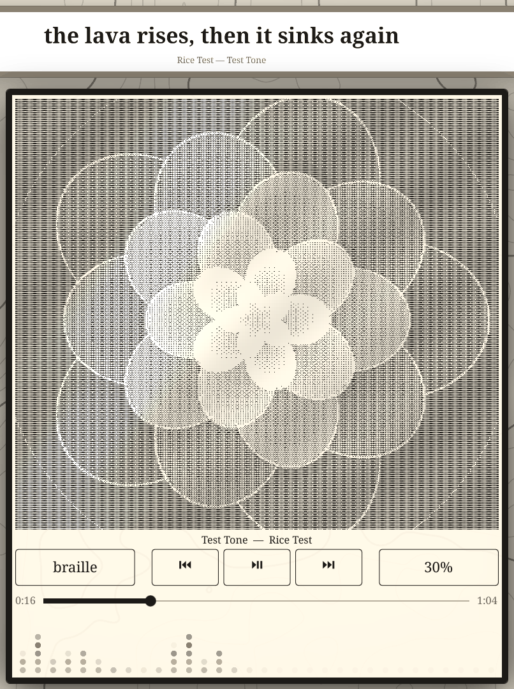</a> | <a href="assets/paper-tablet.png"></a> |

The track in these pictures is a generated test tone, the flower is a generated image and
the wallpapers are drawn by a script. No real album art appears anywhere in this repository.

### Your own

A flavour is one JSON file in `flavours/`: colours, shapes, panel settings and a tile map.
Copy one, change it, and run `rice flavour yourname`. `tools/wallpapers.py` shows how the five
wallpapers are drawn.

## What is in it

- **The toggle.** One script, `rice`, with a panel button and two shortcuts. Your `kdeglobals`,
  GTK colours, window rules and wallpaper are saved when it turns on and restored byte for byte
  when it turns off. Changing flavour keeps that saved copy.
- **Lyrics bar.** Follows whichever music player is actually playing and shows the current line.
  It reads a `.lrc` file next to the track first, then asks [LRCLIB](https://lrclib.net).
  Arabic lines are shaped and laid out right to left.
- **ASCII deck.** Cover art redrawn as characters by a GPU shader, in four modes: character
  ramp, half blocks, braille dots, and a tint in the flavour's colours. When the track changes
  the old picture falls away as rain and the new one decodes in. Play, pause, skip, seek,
  volume and a spectrum strip are built in, for mouse, keyboard and touch.
- **Terminal showcase.** The terminal tile opens on fastfetch with a RAVYN logo lettered
  differently for each flavour, a block clock, and a part that rotates between the playing
  track's cover (drawn by chafa) and six small ASCII scenes that move a little. It never prints
  a user or host name. Press Enter and it becomes an ordinary shell.
- **Classic layout.** `rice layout classic` swaps the deck for
  [cava](https://github.com/karlstav/cava) and [pipes.sh](https://github.com/pipeseroni/pipes.sh).
- **Side panels.** cmatrix and lavat, coloured and shaped by the flavour.
- **Two tile maps per flavour.** Landscape and portrait. Rotate the screen and the panels
  rearrange themselves.
- **Tablet-mode panel service** (optional, for 2-in-1 laptops). Makes the Plasma panel and tray
  icons finger-sized while the screen is folded back, and normal again when it is not.
- **Limits on itself.** Every panel runs in one systemd slice capped at one CPU core and 1.5 GB
  of memory. `rice off` stops that slice and nothing else. Music players are started outside
  it, so turning the rice off never stops your music.

Classic layout, here in NEON:


## Requirements

- KDE Plasma 6 on Wayland
- Arch Linux or an Arch-based system (built and used on CachyOS)
- systemd user session, PipeWire with WirePlumber

Packages are listed in [DEPENDENCIES.md](DEPENDENCIES.md). The installer works out which ones
you are missing.

## Install

```sh
git clone https://github.com/ravynarchlab-source/ravyn-rose.git
cd ravyn-rose
./install.sh --dry-run     # prints every step and changes nothing
./install.sh
```

What the installer does, in order:

1. Installs missing packages with `pacman` (it asks first, as pacman does). Packages that are
   not in your repositories go to `paru` or `yay` if you have one, and are skipped with a note
   if you do not.
2. Copies anything it is about to replace into `~/.local/state/ravyn-rose/backup`.
3. Copies the rice to `~/.local/share/rice`.
4. Downloads the Monocraft font from its own release page and checks its SHA-256.
5. Runs `rice setup`: launchers, shortcuts, the resource-limit slice, the panel button.

Options: `--touch` adds the tablet-mode panel service, `--no-deps` leaves packages alone,
`--no-button` skips the panel button, `--no-setup` only copies files.

It does not turn the rice on. Do that yourself:

```sh
rice on
```

## Use

| Command | What it does |
|---|---|
| `rice on` / `rice off` | Turn it on, or put everything back |
| `rice toggle` | Whichever applies. This is what the panel button runs |
| `rice flavour NAME` | Switch flavour. No name opens the picker; `random` and `list` also work |
| `rice status` | Flavour, what is running, memory and CPU time |
| `rice player pear\|fooyin\|auto` | Which player gets the music tile |
| `rice layout deck\|classic` | ASCII deck, or cava and pipes |
| `rice uninstall` | Turn off and remove everything `rice setup` created |

| Shortcut | Action |
|---|---|
| Meta+Alt+N | rice on |
| Meta+Alt+O | rice off |
| Meta+Alt+PgUp / PgDn | Volume up / down |
| Meta+Alt+, / . | Previous / next track |

A shortcut is only registered if the key is free. If one is taken, `rice setup` leaves it
alone and says so in `~/.local/state/rice/log`. The flavour picker is also in the application
menu as "Rice flavour".

Inside the deck:

| Action | Keyboard | Mouse or touch |
|---|---|---|
| Play / pause | Space | the middle button |
| Previous / next | Left / Right | the outer buttons, or swipe across the art |
| Volume | `+` and `-` | wheel on the art, or drag up and down |
| Mute | M | tap the volume read-out |
| Seek | | click the progress bar |
| Art mode | Tab, or 1 to 4 | tap the mode name |
| Larger characters | Z | |
| Fill or fit the cover | F | |

Inside the terminal showcase: Enter, Space or `q` for a shell, any other key for the next page.

### Players

The lyrics bar and the deck follow [fooyin](https://www.fooyin.org) and
[Pear Desktop](https://github.com/pear-devs/pear-desktop) through MPRIS. Browsers are ignored
on purpose. Pear Desktop is the heavy one: when I measured, it used more CPU than all the
rice panels together.

### Changing things

- **Terminal tile:** `RICE_TERM_CMD="htop" rice on` runs something else in it;
  `RICE_TERM_CMD=shell` gives a plain shell.
- **Everything a flavour sets** (colours, gaps, frame width, button shape, tile map, panel
  options) is in its file in `flavours/`.
- **Scenes:** each file in `showcase/scenes/` is one scene; add your own.
- **Wallpapers:** `tools/wallpapers.py` draws all five (needs `python-numpy`).

All of these live in `~/.local/share/rice` after install.

## Tablet mode

`./install.sh --touch` adds a small user service, `touch-mode-panel`. It listens for KWin's
tablet-mode signal. When the screen folds back, the panel grows to 52 px and tray icons scale
with it; when it unfolds, the saved height comes back. `TOUCH_HEIGHT` in the script sets the
size.

```sh
touch-mode-panel status
systemctl --user disable --now touch-mode-panel.service
```

## Uninstall

```sh
./uninstall.sh --dry-run
./uninstall.sh
```

This runs `rice off` first, so your look is restored from the toggle's own byte-exact copy.
Then it removes the files, launchers and shortcuts, and copies back anything that existed
before the install. Packages stay installed. The backup folder stays too, until you delete it
or pass `--purge`.

## What it sends over the network

- **Lyrics.** When a track has no `.lrc` file next to it, the artist, title, album and length
  are sent to lrclib.net to look up synced lyrics. Answers are cached in `~/.cache/rice`.
- **Cover art.** If your player reports the cover as a web address, that image is downloaded
  and cached.

That is all. No accounts, no keys, no telemetry, and it never reads a browser's or a player's
own data.

## Tested, and not

Built and used on one machine: CachyOS, Plasma 6.8, Wayland, a 2-in-1 laptop at 1920 x 1080
with 125 % scaling. All five flavours, both layouts, the portrait map and the off-and-restore
cycle were run there; the tablet pictures above were taken with the screen folded back.

- **Start-up of the terminal tile.** The showcase draws its first frame less than 100 ms after
  it starts (it logs the figure). The terminal emulator's own start comes on top of that: about
  half a second alone on this laptop, around two seconds when every panel launches at once.
- **Album art in the terminal.** The chafa path has not been run yet on the machine this was
  built on; so far only the built-in fallback, which draws half blocks with Pillow, has.
- **The installer** has been run as a dry run and into an empty home folder, then uninstalled
  again with the earlier files coming back. It has not yet been run on a freshly installed
  system, so read the dry run before you trust it.
- Multi-monitor setups and X11 are untested.

## Credits

None of the programs or fonts below are included in this repository. They are installed from
your distribution or downloaded from their authors, and each keeps its own licence.

| Project | Used for | Licence |
|---|---|---|
| [Monocraft](https://github.com/IdreesInc/Monocraft) by Idrees Hassan | Pixel font in the lyrics bar and deck | SIL OFL 1.1 |
| [Cascadia Code](https://github.com/microsoft/cascadia-code), patched by [Nerd Fonts](https://github.com/ryanoasis/nerd-fonts) | Terminal panels | SIL OFL 1.1 |
| [Noto fonts](https://fonts.google.com/noto) (Kufi Arabic, Serif) | Arabic lyric lines; the PAPER flavour | SIL OFL 1.1 |
| [Alacritty](https://github.com/alacritty/alacritty) | Terminal panels | Apache-2.0 / MIT |
| [fastfetch](https://github.com/fastfetch-cli/fastfetch) | System facts in the showcase | MIT |
| [chafa](https://hpjansson.org/chafa/) | Album art in the showcase | LGPL-3.0-or-later |
| [cava](https://github.com/karlstav/cava) | Spectrum data and the classic visualizer | MIT |
| [cmatrix](https://github.com/abishekvashok/cmatrix) | Matrix panel | GPL-3.0 |
| [lavat](https://github.com/AngelJumbo/lavat) | Lava panel | MIT |
| [pipes.sh](https://github.com/pipeseroni/pipes.sh) | Pipes panel | MIT |
| [fish](https://fishshell.com) | Shell behind the showcase | GPL-2.0 |
| [fooyin](https://www.fooyin.org) | Music player | GPL-3.0 |
| [Pear Desktop](https://github.com/pear-devs/pear-desktop) | Music player | MIT |
| [playerctl](https://github.com/altdesktop/playerctl) | Reading and driving players over MPRIS | LGPL-3.0 |
| [LRCLIB](https://lrclib.net) | Synced lyrics lookup | free public API (server is MIT) |
| [Qt 6](https://www.qt.io) and [PySide6](https://doc.qt.io/qtforpython-6/) | Lyrics window and deck | LGPL-3.0 |
| [Pillow](https://python-pillow.org) | Preparing cover art for the shader | MIT-CMU |
| [KDE Plasma, KWin, Breeze](https://kde.org/plasma-desktop/) | The desktop all of this sits on | LGPL-2.0-or-later |
| [PipeWire](https://pipewire.org) and WirePlumber | Volume control | MIT |

## Licence

Everything in this repository is my own work and is released under the [MIT licence](LICENSE):
the scripts, the QML, the shaders, the flavours, the logos and scenes, and the wallpapers,
which `tools/wallpapers.py` draws from noise and geometry.
